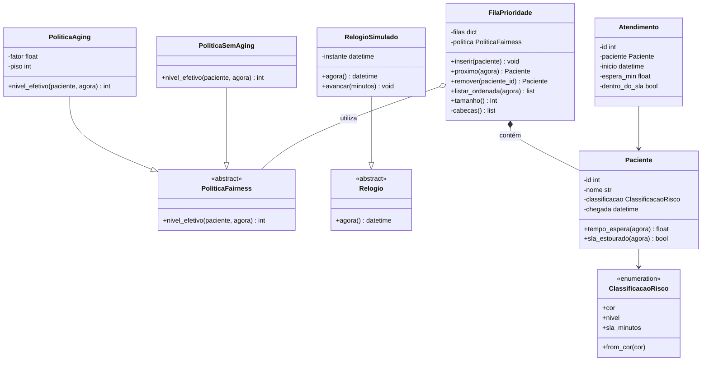
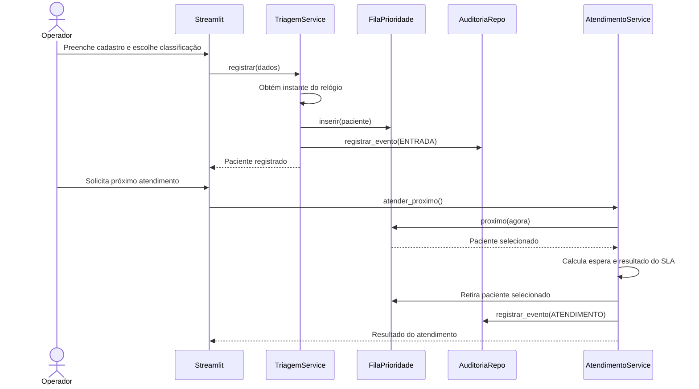

# Arquitetura e diagramas UML

> **Status: arquitetura proposta.** O desenho abaixo deriva do planejamento técnico v0.2. Confirmar nomes, responsabilidades e decisões pendentes com a equipe antes de congelar o modelo final.

## 1. Visão arquitetural

A aplicação é organizada em camadas, com dependências apontando para o domínio:

- **Apresentação (`app/`)**: páginas Streamlit, formulários, tabelas e indicadores. Não implementa regras de negócio.
- **Serviços (`src/triagem/servicos/`)**: coordenam casos de uso, fila, relógio e persistência.
- **Domínio (`src/triagem/dominio/`)**: entidades, enumerações, regras e exceções. Não importa Streamlit, SQLite ou módulos de interface.
- **Fila e políticas (`src/triagem/fila/`)**: estrutura de dados e políticas de prioridade/fairness. Não acessa UI nem banco.
- **Persistência (`src/triagem/persistencia/`)**: repositórios SQLite e exportação de auditoria SQL.

A regra de dependência é: interface → serviços → domínio. Persistência é acessada por abstrações/contratos usados pelos serviços; o domínio permanece independente de I/O.

## 2. Estrutura de módulos proposta

```text
src/triagem/
├── dominio/
│   ├── paciente.py
│   ├── atendimento.py
│   ├── classificacao_risco.py
│   └── excecoes.py
├── fila/
│   ├── fila_prioridade.py
│   └── politicas.py
├── servicos/
│   ├── triagem_service.py
│   ├── atendimento_service.py
│   └── metricas_service.py
├── persistencia/
│   ├── auditoria_repo.py
│   └── exportador_sql.py
└── config.py

app/
├── Home.py
├── pages/
└── components/
```

A árvore é uma proposta de organização; não implica que todos os módulos já estejam implementados.

## 3. Diagrama de classes — núcleo



## 4. Diagrama de sequência — entrada e atendimento



## 5. Responsabilidades das classes

| Classe | Responsabilidade principal |
|---|---|
| `ClassificacaoRisco` | Representar os níveis simulados, cores e SLA configurável |
| `Paciente` | Manter dados e instante de chegada; calcular espera/SLA |
| `Atendimento` | Representar o atendimento realizado e seus indicadores |
| `FilaPrioridade` | Inserir, selecionar, remover e listar pacientes |
| `PoliticaFairness` | Definir contrato para cálculo do nível efetivo |
| `PoliticaAging` | Promover prioridade efetiva conforme espera |
| `PoliticaSemAging` | Servir como baseline experimental sem promoção |
| `Relogio` | Abstrair a fonte temporal |
| `RelogioSimulado` | Permitir avançar o tempo de forma determinística |
| `TriagemService` | Coordenar cadastro, inserção e auditoria de entrada |
| `AtendimentoService` | Coordenar seleção, cálculo de SLA, retirada e auditoria |
| `MetricasService` | Consolidar indicadores para a interface |
| `AuditoriaRepo` | Persistir eventos no SQLite |
| `ExportadorSQL` | Exportar histórico como comandos SQL executáveis |

## 6. Princípios de orientação a objetos

- **Encapsulamento:** a fila mantém suas estruturas internas privadas; outras camadas usam métodos públicos.
- **Abstração:** `Relogio` e `PoliticaFairness` definem contratos.
- **Polimorfismo:** `RelogioSimulado` e as políticas concretas podem ser substituídos sem alterar os serviços consumidores.
- **Composição:** `FilaPrioridade` contém pacientes.
- **Injeção de dependência:** serviços recebem fila, relógio e repositórios por construtor, facilitando testes.
- **Responsabilidade única:** cada classe deve ter uma razão principal para mudar.

## 7. Pontos a confirmar

- nomes finais das classes e métodos;
- se haverá implementação de relógio real além do relógio simulado;
- assinatura definitiva dos métodos e exceções;
- parâmetros de aging;
- fronteira exata entre serviços e repositórios;
- se o docente exige UML de todos os métodos/atributos ou do núcleo principal.

Este documento não substitui o dicionário detalhado de classes e métodos exigido no planejamento; esse artefato deve ser mantido em `docs/dicionario.md` quando as assinaturas reais estiverem definidas.
