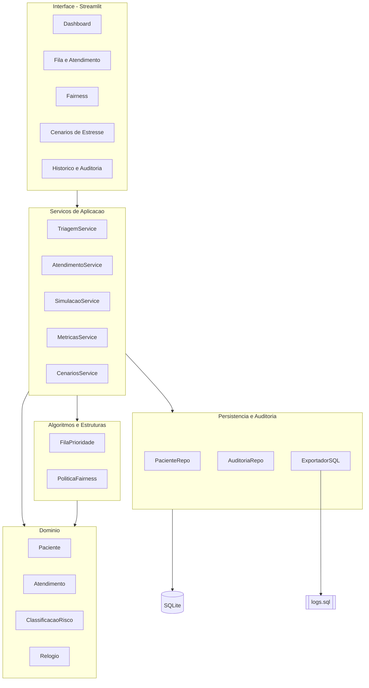
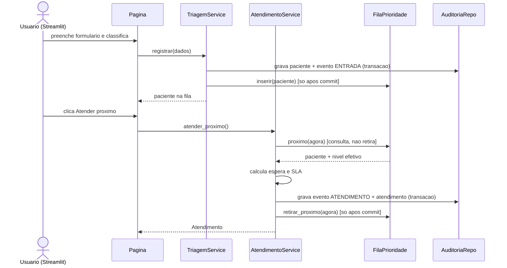

# Arquitetura e diagramas UML

> **Status: arquitetura v0.3, proposta para validação da equipe.** Este documento segue o Planejamento Técnico v0.3. Nomes de classes e assinaturas podem mudar até o congelamento dos contratos; toda mudança passa por PR.

## 1. Visão geral

Uma aplicação **Streamlit** (apresentação) chama **serviços de aplicação** que orquestram o **domínio** (entidades e regras) e a **fila de prioridade** (algoritmo/estrutura de dados), e gravam eventos via **repositórios** no banco SQL. A regra de ouro: **dependências apontam para dentro** — a UI conhece os serviços; os serviços conhecem o domínio; o domínio não conhece ninguém.

## 2. Camadas e responsabilidades

| Camada | Pasta | Responsabilidade | Não pode |
|---|---|---|---|
| Domínio | `src/triagem/dominio/` | Entidades (`Paciente`, `Atendimento`), enums (`ClassificacaoRisco`, `TipoEvento`), relógio, regras de SLA, exceções | Importar Streamlit, SQL ou I/O |
| Algoritmos / Estruturas | `src/triagem/fila/` | `FilaPrioridade`, políticas de fairness (aging e baseline) | Acessar banco ou UI |
| Aplicação (serviços) | `src/triagem/servicos/` | Casos de uso: registrar, atender, remover, avançar relógio, métricas, cenários | Conter regra de ordenação ou SQL cru |
| Persistência / Auditoria | `src/triagem/persistencia/` | Conexão, repositórios, exportador `logs.sql` | Decidir regra de negócio |
| Interface | `app/` | Páginas Streamlit e componentes de exibição | Acessar banco direto; ordenar fila |

## 3. Estrutura de diretórios

```text
sus-priority-scheduler/
├── README.md
├── pyproject.toml                  # dependências, pytest e ruff
├── .gitignore
├── .github/
│   ├── pull_request_template.md
│   └── workflows/ci.yml            # [Recomendação] pytest + ruff
├── docs/
│   ├── BOAS_PRATICAS.md
│   ├── AUTORIA.md                  # arquivo → autor → revisor
│   ├── relatorio_tecnico.md
│   ├── regras_de_negocio.md
│   ├── arquitetura_e_uml.md
│   ├── dicionario.md
│   ├── wireframe.md
│   ├── diagramas/                  # .mmd (Mermaid) versionados
│   └── decisoes/                   # registro de decisões (ADR curtos)
├── sql/
│   ├── schema.sql                  # somente DDL (estrutura)
│   └── logs.sql                    # gerado pela aplicação (catálogo + histórico)
├── src/triagem/
│   ├── __init__.py
│   ├── config.py                   # SLAs, K, piso, caminho do banco
│   ├── container.py                # monta os objetos (injeção de dependências)
│   ├── dominio/
│   │   ├── enums.py                # ClassificacaoRisco, TipoEvento, MotivoRemocao
│   │   ├── paciente.py
│   │   ├── atendimento.py
│   │   ├── evento.py               # EventoFila (registro de auditoria)
│   │   ├── relogio.py              # Relogio, RelogioSimulado, RelogioSistema
│   │   └── excecoes.py
│   ├── fila/
│   │   ├── fila_prioridade.py
│   │   └── politicas.py            # PoliticaFairness, PoliticaAging, PoliticaSemAging
│   ├── servicos/
│   │   ├── triagem_service.py
│   │   ├── atendimento_service.py
│   │   ├── simulacao_service.py    # avança relógio e registra transições
│   │   ├── metricas_service.py
│   │   └── cenarios_service.py
│   └── persistencia/
│       ├── conexao.py
│       ├── paciente_repo.py
│       ├── auditoria_repo.py
│       └── exportador_sql.py
├── app/
│   ├── main.py                     # streamlit run app/main.py
│   ├── pages/
│   │   ├── 1_Dashboard.py
│   │   ├── 2_Fila_e_Atendimento.py
│   │   ├── 3_Fairness.py
│   │   ├── 4_Cenarios_de_Estresse.py
│   │   └── 5_Historico_e_Auditoria.py
│   └── componentes/
└── tests/
    ├── unit/
    ├── integration/
    └── cenarios/                   # starvation com e sem aging (T1–T7)
```

## 4. Diagrama de arquitetura



## 5. Diagrama de classes (UML v0.3 — completo)

Legenda: `+` público, `-` privado, `#` protegido; `*` após o método = abstrato. A herança vem das políticas de justiça e do relógio (polimorfismo real, não decorativo).

**Agregação, não composição, entre fila e paciente:** o paciente continua existindo depois de sair da fila (é referenciado pelo `Atendimento` e pela auditoria), então a fila não controla o ciclo de vida dele. A composição fica onde ela é verdadeira: a `FilaPrioridade` *cria e destrói* seus `deque` internos.

```mermaid
classDiagram
    class ClassificacaoRisco {
        <<enumeration>>
        VERMELHO
        LARANJA
        AMARELO
        VERDE
        AZUL
        +cor str
        +nivel int
        +sla_minutos int
        +from_cor(cor str)$ ClassificacaoRisco
    }
    class TipoEvento {
        <<enumeration>>
        ENTRADA
        PROMOCAO_AGING
        ATENDIMENTO
        REMOCAO
        ATRASO_SLA
    }
    class Paciente {
        -id int
        -nome str
        -idade int
        -queixa str
        -classificacao ClassificacaoRisco
        -chegada datetime
        +tempo_espera(agora datetime) float
        +limite_sla() datetime
        +sla_estourado(agora datetime) bool
    }
    class Atendimento {
        <<frozen dataclass>>
        +paciente_id int
        +inicio datetime
        +espera_min float
        +dentro_do_sla bool
        +nivel_efetivo int
    }
    class EventoFila {
        <<frozen dataclass>>
        +paciente_id int
        +tipo TipoEvento
        +instante datetime
        +nivel_efetivo int
        +detalhes str
        +contagem_por_cor dict
    }
    class Relogio {
        <<abstract>>
        +agora()* datetime
    }
    class RelogioSimulado {
        -instante datetime
        +agora() datetime
        +avancar(minutos float) void
    }
    class RelogioSistema {
        +agora() datetime
    }
    class PoliticaFairness {
        <<abstract>>
        +nivel_efetivo(p Paciente, agora datetime)* int
        +promocoes_no_intervalo(p Paciente, inicio datetime, fim datetime)* list
    }
    class PoliticaAging {
        -fator float
        -piso int
        +nivel_efetivo(p, agora) int
        +promocoes_no_intervalo(p, inicio, fim) list
    }
    class PoliticaSemAging {
        +nivel_efetivo(p, agora) int
        +promocoes_no_intervalo(p, inicio, fim) list
    }
    class FilaPrioridade {
        -filas dict~ClassificacaoRisco, deque~
        -politica PoliticaFairness
        +inserir(p Paciente) void
        +proximo(agora datetime) Paciente
        +retirar_proximo(agora datetime) Paciente
        +remover(paciente_id int) Paciente
        +listar_ordenada(agora datetime) list
        +aguardando() list
        +promocoes_entre(inicio datetime, fim datetime) list
        +contagem_por_cor() dict
        +tamanho() int
        -chave(p Paciente, agora datetime) tuple
        -cabecas() list
    }
    class TriagemService {
        -fila FilaPrioridade
        -pacientes PacienteRepo
        -auditoria AuditoriaRepo
        -relogio Relogio
        +registrar(dados dict) Paciente
        +remover(paciente_id int, motivo MotivoRemocao) void
    }
    class AtendimentoService {
        -fila FilaPrioridade
        -auditoria AuditoriaRepo
        -relogio Relogio
        +atender_proximo() Atendimento
    }
    class SimulacaoService {
        -fila FilaPrioridade
        -auditoria AuditoriaRepo
        -relogio RelogioSimulado
        +avancar_relogio(minutos float) list
    }
    class MetricasService {
        -fila FilaPrioridade
        -auditoria AuditoriaRepo
        -relogio Relogio
        +resumo() dict
        +atrasados() list
    }
    class CenariosService {
        +executar(cenario str, semente int, politica PoliticaFairness) dict
    }
    class PacienteRepo {
        -conexao ConexaoFactory
        +inserir(p Paciente) int
        +buscar(paciente_id int) Paciente
    }
    class AuditoriaRepo {
        -conexao ConexaoFactory
        +registrar(eventos list, atendimento Atendimento) void
        +historico(paciente_id int) list
        +atendimentos() list
    }
    class ExportadorSQL {
        -auditoria AuditoriaRepo
        +exportar(caminho str) void
    }

    Paciente --> ClassificacaoRisco
    EventoFila --> TipoEvento
    Atendimento ..> Paciente : paciente_id
    RelogioSimulado --|> Relogio
    RelogioSistema --|> Relogio
    PoliticaAging --|> PoliticaFairness
    PoliticaSemAging --|> PoliticaFairness
    FilaPrioridade o-- Paciente : agrega
    FilaPrioridade o-- PoliticaFairness : usa
    TriagemService --> FilaPrioridade
    TriagemService --> PacienteRepo
    TriagemService --> AuditoriaRepo
    AtendimentoService --> FilaPrioridade
    AtendimentoService --> AuditoriaRepo
    SimulacaoService --> FilaPrioridade
    SimulacaoService --> RelogioSimulado
    SimulacaoService --> AuditoriaRepo
    MetricasService --> FilaPrioridade
    MetricasService --> AuditoriaRepo
    CenariosService ..> FilaPrioridade : cria isoladas
    ExportadorSQL --> AuditoriaRepo
```



## 6. Principais classes

| Classe | Atributos-chave | Métodos-chave | Observações |
|---|---|---|---|
| `ClassificacaoRisco` (Enum) | cor, nivel (1–5), sla_minutos | `from_cor()` | Valores lidos de `config.py`; validação na carga: SLA > 0 para níveis 2–5 (evita divisão por zero no aging) |
| `Paciente` | id, nome, idade, queixa, classificação, chegada | `tempo_espera(agora)`, `limite_sla()`, `sla_estourado(agora)` | Dados fictícios; sem dado pessoal real |
| `Atendimento` | paciente_id, início, espera, dentro_do_sla, nível efetivo | — | Resultado imutável (`dataclass(frozen=True)`) |
| `EventoFila` | tipo, instante, nível efetivo, detalhes, contagem por cor | — | Uma linha de `evento_fila`; imutável |
| `Relogio` / `RelogioSimulado` / `RelogioSistema` | instante atual | `agora()`, `avancar(min)` | Simulado na demo e nos testes; o do sistema mostra a troca por polimorfismo |
| `PoliticaFairness` (abstrata) | — | `nivel_efetivo()`, `promocoes_no_intervalo()` | Contrato das políticas; `PoliticaSemAging` é o baseline que demonstra starvation |
| `PoliticaAging` | fator K, piso | idem | Isola a regra de fairness; fácil de explicar e trocar |
| `FilaPrioridade` | 5 `deque` (uma por cor), política | `inserir`, `proximo`, `retirar_proximo`, `remover`, `listar_ordenada` | Coração do trabalho (nota de demonstração) |
| `TriagemService` | fila, repos, relógio | `registrar`, `remover` | Entrada e saída por desistência/erro |
| `AtendimentoService` | fila, repo, relógio | `atender_proximo` | Calcula espera e SLA e grava evento + atendimento |
| `SimulacaoService` | fila, repo, relógio simulado | `avancar_relogio` | Única forma de mover o tempo; grava `PROMOCAO_AGING` e `ATRASO_SLA` |
| `MetricasService` | fila, histórico | `resumo`, `atrasados` | Alimenta o dashboard |
| `CenariosService` | — | `executar` | Roda cenários em fila e banco isolados (`:memory:`), sem sujar a auditoria real |
| `AuditoriaRepo` | fábrica de conexão | `registrar`, `historico` | Somente INSERT (append-only) |
| `ExportadorSQL` | repo | `exportar` | Gera `logs.sql` executável |

**Relacionamentos:** agregação (fila agrega pacientes e usa uma política), associação (serviços usam fila e repositórios), herança/realização (relógios e políticas), dependência de enum. **Princípios POO a demonstrar:** encapsulamento (a fila esconde suas estruturas internas), abstração (`Relogio`, `PoliticaFairness`), polimorfismo (relógios e políticas intercambiáveis) e injeção de dependências pelo construtor (`container.py`).

## 6b. Dicionário de classes, métodos e estruturas de dados (rascunho)

O dicionário completo fica em `docs/dicionario.md`, com uma entrada por classe e por método público. Modelo de entrada e exemplo da classe central:

| Método de `FilaPrioridade` | Assinatura | O que faz | Exceções | Complexidade |
|---|---|---|---|---|
| `inserir` | `inserir(p: Paciente) -> None` | Coloca o paciente no fim da fila da sua cor | `PacienteInvalidoError` se id repetido | O(1) |
| `proximo` | `proximo(agora: datetime) -> Paciente` | Escolhe a melhor entre as 5 cabeças por `(nível efetivo, chegada, id)`, **sem retirar** | `FilaVaziaError` | O(1) |
| `retirar_proximo` | `retirar_proximo(agora: datetime) -> Paciente` | Mesmo critério de `proximo` e retira com `popleft` da cor escolhida | `FilaVaziaError` | O(1) |
| `remover` | `remover(paciente_id: int) -> Paciente` | Retira um paciente específico (desistência/erro) | `PacienteNaoEncontradoError` | O(n) |
| `listar_ordenada` | `listar_ordenada(agora: datetime) -> list[Paciente]` | Ordem de atendimento atual, para a UI | — | O(n log n) |
| `aguardando` | `aguardando() -> list[Paciente]` | Cópia da lista de quem espera (sem expor os `deque`) | — | O(n) |
| `promocoes_entre` | `promocoes_entre(inicio, fim) -> list[tuple[Paciente, datetime, int]]` | Delega à política: promoções ocorridas em `(inicio, fim]` | — | O(n) |
| `contagem_por_cor` | `contagem_por_cor() -> dict[ClassificacaoRisco, int]` | Estado da fila para a auditoria | — | O(1) |
| `tamanho` | `tamanho() -> int` | Total de pacientes aguardando | — | O(1) |

| Estrutura de dados | Onde é usada | Por que foi escolhida | Custo principal |
|---|---|---|---|
| `collections.deque` (uma por cor) | `FilaPrioridade._filas` | FIFO natural, `append`/`popleft` em tempo constante | O(1) |
| `dict[ClassificacaoRisco, deque]` | `FilaPrioridade._filas` | Acesso direto à fila de cada cor | O(1) |
| tupla `(nível_efetivo, chegada, id)` | Chave de comparação em `proximo()` | Critério de ordenação e desempate explícitos | O(1) |
| `list` + `sorted` | `listar_ordenada()` | Só para exibição | O(n log n) |
| `heapq` | Experimento baseline (relatório) | Comparar com a abordagem escolhida | O(log n) |
| `Enum` + `dataclass` | `ClassificacaoRisco`, `Paciente`, `Atendimento`, `EventoFila` | Valores fixos e entidades legíveis | — |
| Tabelas SQLite | `sql/schema.sql` | Auditoria e histórico | — |

## 7. Fluxos

**Entrada e atendimento**



**Avanço do relógio (onde nascem `PROMOCAO_AGING` e `ATRASO_SLA`)**

```mermaid
sequenceDiagram
    participant UI as Pagina / modo automatico
    participant SS as SimulacaoService
    participant F as FilaPrioridade
    participant AR as AuditoriaRepo
    participant R as RelogioSimulado
    UI->>SS: avancar_relogio(minutos)
    SS->>SS: inicio = R.agora(); fim = inicio + minutos
    SS->>F: promocoes_entre(inicio, fim)
    SS->>F: aguardando()  [limites de SLA no intervalo]
    SS->>AR: grava eventos em ordem de instante (transacao)
    SS->>R: avancar(minutos)  [so apos commit]
    SS-->>UI: lista de eventos gerados
```

## 8. Armazenamento de dados e logs

- **Banco:** SQLite [Recomendação / Pendente: confirmar com o professor que SQLite atende o termo «SQL»] — zero instalação, um arquivo, roda na máquina de todos e na apresentação.
- **Estado da fila:** a fila vive em memória (rápida e simples), mas cada mudança é um evento gravado. Ao reiniciar, a fila pode ser **reconstruída** reaplicando eventos `ENTRADA` − (`ATENDIMENTO` + `REMOCAO`). Isso prova rastreabilidade.
- **Append-only:** nunca `UPDATE`/`DELETE` em auditoria — garantido por *triggers* no `schema.sql`.
- **`logs.sql`:** gerado por `ExportadorSQL` a partir das tabelas, executável em banco limpo criado por `schema.sql` (ver o exemplo em `docs/regras_de_negocio.md`, seção 10).
