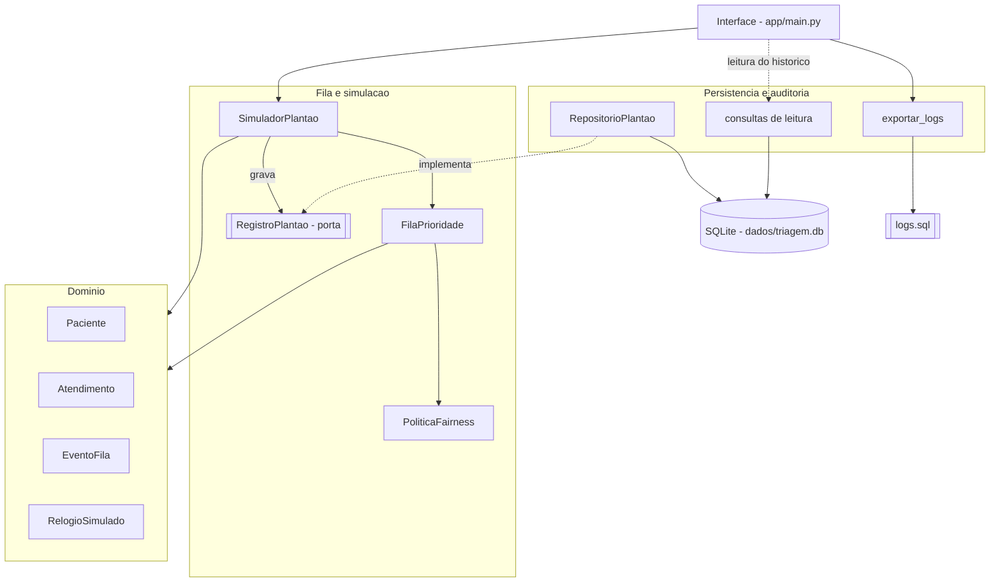
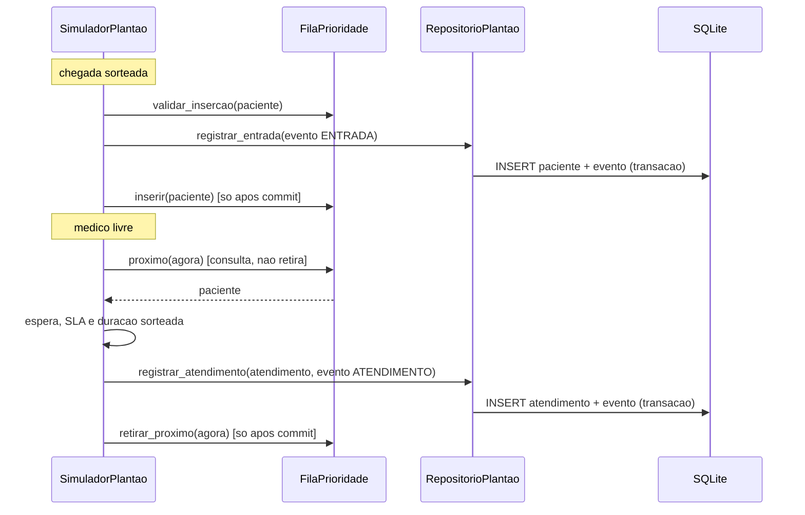
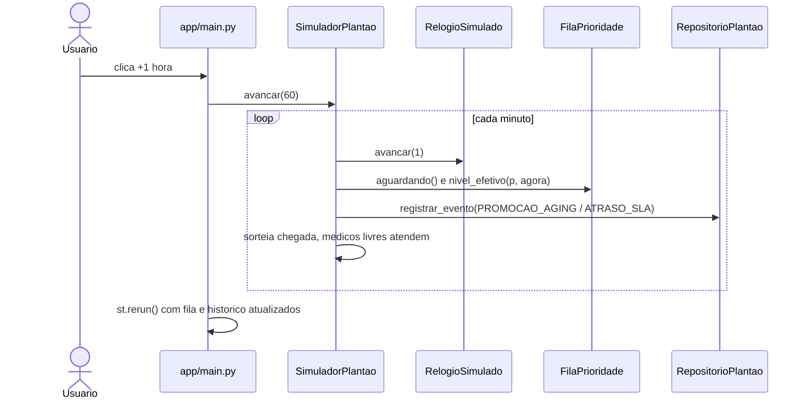

# Arquitetura e diagramas UML

> **Status: v1.0, alinhada ao código da `main` (22/11/2026).** Substitui a proposta v0.3. As diferenças em relação ao planejamento estão na seção 9. Toda mudança passa por PR.

## 1. Visão geral

Uma tela **Streamlit** dispara ações no **simulador de plantão**, que usa a **fila de prioridade** e as **políticas de fairness** sobre as entidades do **domínio**. O simulador grava cada acontecimento por uma **porta abstrata** (`RegistroPlantao`), implementada pelo **repositório SQLite**. A regra de ouro: **dependências apontam para dentro** — a tela conhece o simulador; o simulador conhece a fila e o domínio; o domínio não conhece ninguém. Só a persistência conhece SQL.

## 2. Camadas e responsabilidades

| Camada | Pasta | Responsabilidade | Não pode |
|---|---|---|---|
| Domínio | `src/triagem/dominio/` | Entidades (`Paciente`, `Atendimento`, `EventoFila`), enums (`ClassificacaoRisco`, `TipoEvento`), relógios, regras de SLA, exceções | Importar Streamlit, SQL ou I/O |
| Fila e simulação | `src/triagem/fila/` | `FilaPrioridade`, políticas de fairness, cenário de starvation, `SimuladorPlantao` e a porta `RegistroPlantao` | Acessar banco ou interface |
| Persistência e auditoria | `src/triagem/persistencia/` | Conexão, `RepositorioPlantao`, consultas de leitura, exportador do `logs.sql` | Decidir regra de negócio |
| Interface | `app/main.py` | Exibir fila, métricas e histórico; disparar ações | Ordenar a fila ou decidir regras |

## 3. Estrutura de diretórios

```text
sus-priority-scheduler/
├── README.md
├── pyproject.toml                  # dependências, pytest e ruff
├── requirements.txt
├── .github/pull_request_template.md
├── app/
│   └── main.py                     # streamlit run app/main.py
├── docs/
│   ├── BOAS_PRATICAS.md
│   ├── arquitetura_e_uml.md
│   ├── regras_de_negocio.md
│   └── wireframe.md
├── script/
│   └── demo_starvatio.py           # demo de terminal T1/T2
├── sql/
│   └── schema.sql                  # somente DDL (estrutura)
├── src/triagem/
│   ├── config.py                   # SLAs, K, piso, duração da consulta, caminhos
│   ├── dominio/
│   │   ├── enums.py                # ClassificacaoRisco, TipoEvento (+ validação de SLA)
│   │   ├── paciente.py
│   │   ├── atendimento.py
│   │   ├── evento.py               # EventoFila (registro de auditoria)
│   │   ├── relogio.py              # Relogio, RelogioSimulado, RelogioSistema
│   │   └── excecoes.py
│   ├── fila/
│   │   ├── fila_prioridade.py
│   │   ├── politicas.py            # PoliticaFairness, PoliticaAging, PoliticaSemAging
│   │   ├── cenario_starvation.py   # T1/T2: 1 Azul contra fluxo de Laranjas
│   │   └── plantao.py              # ConfigPlantao, RegistroPlantao, SimuladorPlantao
│   └── persistencia/
│       ├── conexao.py              # abre o SQLite e aplica schema.sql
│       ├── repositorio.py          # RepositorioPlantao + consultas de leitura
│       └── exportador_sql.py       # gera o logs.sql
└── tests/
    ├── unit/                       # domínio, fila, simulador
    ├── integration/                # persistência SQLite
    └── cenarios/                   # starvation T1–T4
```

O banco local fica em `dados/triagem.db`, ignorado pelo Git.

## 4. Diagrama de arquitetura



A linha tracejada da interface para as consultas é um desvio da regra das camadas (pendente de confirmação da equipe): a tela lê o histórico direto do banco (funções `eventos`, `atendimentos`, `listar_plantoes` e `buscar_pacientes`), sem passar pelo simulador. Nenhuma dessas funções grava nada.

## 5. Diagrama de classes

Legenda: `+` público, `-` privado; `*` após o método = abstrato; `$` = estático.

**Agregação, não composição, entre fila e paciente:** o paciente continua existindo depois de sair da fila (é referenciado pelo `Atendimento` e pela auditoria). A composição fica onde ela é verdadeira: a `FilaPrioridade` cria e destrói seus `deque` internos, e o `SimuladorPlantao` cria a sua fila.

```mermaid
classDiagram
    class ClassificacaoRisco {
        <<enumeration>>
        VERMELHO
        LARANJA
        AMARELO
        VERDE
        AZUL
        +nivel int
        +cor str
        +sla_minutos int
        +from_cor(cor str)$ ClassificacaoRisco
        +from_nivel(nivel int)$ ClassificacaoRisco
    }
    class TipoEvento {
        <<enumeration>>
        ENTRADA
        PROMOCAO_AGING
        ATENDIMENTO
        REMOCAO
        ATRASO_SLA
    }
    class Paciente {
        -id int
        -nome str
        -idade int
        -queixa str
        -classificacao ClassificacaoRisco
        -chegada datetime
        +tempo_espera(agora datetime) float
        +limite_sla() datetime
        +sla_estourado(agora datetime) bool
    }
    class Atendimento {
        <<frozen dataclass>>
        +paciente Paciente
        +inicio datetime
        +espera_min float
        +nivel_efetivo int
        +medico int
        +duracao_min int
        +fim datetime
        +dentro_do_sla bool
    }
    class EventoFila {
        <<frozen dataclass>>
        +tipo TipoEvento
        +instante datetime
        +paciente Paciente
        +nivel_efetivo int
        +detalhes str
        +contagem_por_cor dict
        +paciente_id int
        +tamanho_fila int
    }
    class Relogio {
        <<abstract>>
        +agora()* datetime
    }
    class RelogioSimulado {
        -atual datetime
        +agora() datetime
        +avancar(minutos float) void
    }
    class RelogioSistema {
        +agora() datetime
    }
    class PoliticaFairness {
        <<abstract>>
        +nome str
        +nivel_efetivo(p Paciente, agora datetime)* int
        +instante_de_promocao(p Paciente, nivel_alvo int) datetime
    }
    class PoliticaAging {
        -fator float
        -piso int
        +nivel_efetivo(p, agora) int
        +instante_de_promocao(p, nivel_alvo) datetime
    }
    class PoliticaSemAging {
        +nivel_efetivo(p, agora) int
    }
    class FilaPrioridade {
        -filas dict~ClassificacaoRisco, deque~
        -politica PoliticaFairness
        -ids set~int~
        +validar_insercao(p Paciente) void
        +inserir(p Paciente) void
        +proximo(agora datetime) Paciente
        +retirar_proximo(agora datetime) Paciente
        +remover(paciente_id int) Paciente
        +listar_ordenada(agora datetime) list
        +nivel_efetivo(p Paciente, agora datetime) int
        +aguardando() list
        +contagem_por_cor() dict
        +tamanho() int
        -chave(p Paciente, agora datetime) tuple
    }
    class ConfigPlantao {
        <<frozen dataclass>>
        +chegadas_por_hora float
        +medicos int
        +consulta_min int
        +consulta_max int
        +proporcao dict
        +semente int
        +consulta_media_min float
        +capacidade_por_hora float
    }
    class RegistroPlantao {
        <<abstract>>
        +registrar_entrada(evento EventoFila)* void
        +registrar_evento(evento EventoFila)* void
        +registrar_atendimento(atendimento Atendimento, evento EventoFila)* void
    }
    class SimuladorPlantao {
        -fila FilaPrioridade
        -relogio RelogioSimulado
        -config ConfigPlantao
        -registro RegistroPlantao
        +chegadas_automaticas bool
        +adicionar(paciente Paciente) void
        +atender_proximo(medico int) Atendimento
        +avancar(minutos int) void
        +resumo_por_cor() list~ResumoCor~
        +atendimento_de(paciente_id int) Atendimento
        +eventos list
        +atendimentos list
        +amostras list~Amostra~
    }
    class Amostra {
        <<frozen dataclass>>
        +instante datetime
        +aguardando_por_cor dict
        +maior_espera_por_cor dict
    }
    class ResumoCor {
        <<frozen dataclass>>
        +cor ClassificacaoRisco
        +chegaram int
        +atendidos int
        +aguardando int
        +espera_media_atendidos float
        +maior_espera float
        +pct_dentro_sla float
    }
    class RepositorioPlantao {
        -conexao Connection
        -plantao_id int
        +novo_plantao(conexao, politica, config, inicio)$ RepositorioPlantao
        +registrar_entrada(evento) void
        +registrar_evento(evento) void
        +registrar_atendimento(atendimento, evento) void
    }

    Paciente --> ClassificacaoRisco
    EventoFila --> TipoEvento
    EventoFila --> Paciente
    Atendimento --> Paciente
    RelogioSimulado --|> Relogio
    RelogioSistema --|> Relogio
    PoliticaAging --|> PoliticaFairness
    PoliticaSemAging --|> PoliticaFairness
    FilaPrioridade o-- Paciente : agrega
    FilaPrioridade o-- PoliticaFairness : usa
    SimuladorPlantao *-- FilaPrioridade : cria
    SimuladorPlantao --> RelogioSimulado
    SimuladorPlantao --> ConfigPlantao
    SimuladorPlantao o-- RegistroPlantao : grava por
    SimuladorPlantao ..> Amostra : produz
    SimuladorPlantao ..> ResumoCor : produz
    RepositorioPlantao --|> RegistroPlantao
```



## 6. Principais classes

| Classe | Atributos-chave | Métodos-chave | Observações |
|---|---|---|---|
| `ClassificacaoRisco` (Enum) | nível (1–5), cor, SLA | `from_cor()`, `from_nivel()` | SLAs lidos de `config.py`; ao importar, `_validar_sla` exige SLA > 0 nos níveis 2–5 (evita divisão por zero no aging) |
| `Paciente` | id, nome, idade, queixa, classificação, chegada | `tempo_espera`, `limite_sla`, `sla_estourado` | Atributos privados só de leitura; valida os dados no construtor; dados fictícios |
| `Atendimento` | paciente, início, espera, nível efetivo, médico, duração | `fim`, `dentro_do_sla` | `dataclass(frozen=True)`; médico `None` = chamada manual |
| `EventoFila` | tipo, instante, paciente, nível efetivo, detalhes, contagem por cor | `paciente_id`, `tamanho_fila` | Uma linha de `evento_fila`; imutável |
| `Relogio` / `RelogioSimulado` / `RelogioSistema` | instante atual | `agora()`, `avancar(min)` | Simulado na tela e nos testes; o do sistema mostra a troca por polimorfismo |
| `PoliticaFairness` (abstrata) | `nome` | `nivel_efetivo()`, `instante_de_promocao()` | Contrato das políticas; o `nome` é gravado na tabela `plantao` |
| `PoliticaSemAging` | — | `nivel_efetivo()` | Baseline que demonstra a starvation |
| `PoliticaAging` | fator K, piso | `nivel_efetivo()`, `instante_de_promocao()` | Recusa K ≤ 0 e piso fora de 1–5 |
| `FilaPrioridade` | 5 `deque`, política, ids | `inserir`, `proximo`, `retirar_proximo`, `remover`, `listar_ordenada` | Coração do trabalho |
| `ConfigPlantao` | chegadas/h, médicos, limites da consulta, proporção de cores, semente | `capacidade_por_hora` | Recusa parâmetros sem sentido |
| `RegistroPlantao` (abstrata) | — | `registrar_entrada`, `registrar_evento`, `registrar_atendimento` | Porta de gravação: o simulador não conhece SQL |
| `SimuladorPlantao` | fila, relógio, configuração, registro, sorteadores | `adicionar`, `atender_proximo`, `avancar`, `resumo_por_cor` | Única forma de mover o tempo; gera chegadas, atendimentos, `PROMOCAO_AGING` e `ATRASO_SLA` |
| `RepositorioPlantao` | conexão, id do plantão | `novo_plantao`, métodos da porta | Uma transação por método; somente INSERT |

Funções de módulo: `rodar_plantao` (plantão completo, usado em T3/T4), `simular_starvation` e `montar_fila_inicial` (cenário T1/T2), `abrir_conexao`, consultas de leitura (`listar_plantoes`, `eventos`, `atendimentos`, `buscar_pacientes`) e `exportar_logs`.

**Relacionamentos:** agregação (a fila agrega pacientes e usa uma política; o simulador grava por uma porta), composição (o simulador cria a fila; a fila cria seus `deque`), herança/realização (relógios, políticas e repositório), dependência de enum. **Princípios POO demonstrados:** encapsulamento (atributos privados do `Paciente`; a fila não expõe os `deque`), abstração (`Relogio`, `PoliticaFairness`, `RegistroPlantao`), polimorfismo (a mesma fila funciona com ou sem aging; rodar com ou sem banco) e injeção de dependências pelo construtor.

## 6b. Dicionário da `FilaPrioridade` e estruturas de dados

| Método | Assinatura | O que faz | Exceções | Complexidade |
|---|---|---|---|---|
| `validar_insercao` | `validar_insercao(p: Paciente) -> None` | Checa id repetido e chegada fora de ordem, sem alterar nada; usado antes de gravar no banco | `PacienteInvalidoError` | O(1) |
| `inserir` | `inserir(p: Paciente) -> None` | Valida e coloca o paciente no fim da fila da sua cor | `PacienteInvalidoError` | O(1) |
| `proximo` | `proximo(agora: datetime) -> Paciente` | Escolhe a melhor entre as 5 cabeças por `(nível efetivo, chegada, id)`, **sem retirar** | `FilaVaziaError` | O(1) |
| `retirar_proximo` | `retirar_proximo(agora: datetime) -> Paciente` | Mesmo critério de `proximo` e retira com `popleft` | `FilaVaziaError` | O(1) |
| `remover` | `remover(paciente_id: int) -> Paciente` | Retira um paciente específico (desistência/erro) | `PacienteNaoEncontradoError` | O(n) |
| `listar_ordenada` | `listar_ordenada(agora: datetime) -> list[Paciente]` | Ordem de atendimento atual, para a tela | — | O(n log n) |
| `nivel_efetivo` | `nivel_efetivo(p: Paciente, agora: datetime) -> int` | Delega à política de fairness | — | O(1) |
| `aguardando` | `aguardando() -> list[Paciente]` | Cópia da lista de quem espera (sem expor os `deque`) | — | O(n) |
| `contagem_por_cor` | `contagem_por_cor() -> dict[ClassificacaoRisco, int]` | Estado da fila para a auditoria | — | O(1) |
| `tamanho` / `len()` | `tamanho() -> int` | Total de pacientes aguardando | — | O(1) |

| Estrutura de dados | Onde é usada | Por que foi escolhida | Custo principal |
|---|---|---|---|
| `collections.deque` (uma por cor) | `FilaPrioridade._filas` | FIFO natural, `append`/`popleft` em tempo constante | O(1) |
| `dict[ClassificacaoRisco, deque]` | `FilaPrioridade._filas` | Acesso direto à fila de cada cor | O(1) |
| `set[int]` | `FilaPrioridade._ids` | Detectar id repetido sem percorrer a fila | O(1) |
| tupla `(nível_efetivo, chegada, id)` | Chave de comparação em `proximo()` | Critério de ordenação e desempate explícitos | O(1) |
| `list` + `sorted` | `listar_ordenada()` | Só para exibição | O(n log n) |
| `random.Random(semente)` | `SimuladorPlantao` | Mesma semente, mesmo plantão; gerador separado para a duração das consultas | — |
| `Enum` + `dataclass(frozen=True)` | Cores, eventos, atendimento, configuração, amostras | Valores fixos e registros imutáveis | — |
| Tabelas SQLite | `sql/schema.sql` | Auditoria e histórico | — |

## 7. Fluxos

**Chegada e atendimento (dentro de um minuto simulado)**



**Avanço do relógio (onde nascem `PROMOCAO_AGING` e `ATRASO_SLA`)**



## 8. Armazenamento de dados e logs

- **Banco:** SQLite em `dados/triagem.db` [Pendente: confirmar com o professor que SQLite atende o termo «SQL»] — zero instalação, um arquivo. WAL e `synchronous = NORMAL` no arquivo; `:memory:` nos testes.
- **Plantão:** cada execução da tela é uma linha da tabela `plantao`, com política, chegadas/h, médicos, limites da consulta e semente. Pacientes, eventos e atendimentos ficam ligados ao plantão.
- **Estado da fila:** a fila vive em memória, mas cada mudança é gravada **antes** de acontecer nela. Se a gravação falhar, a fila não muda. A fila pode ser reconstruída pelos eventos: `ENTRADA` − (`ATENDIMENTO` + `REMOCAO`).
- **Append-only:** *triggers* no `schema.sql` bloqueiam `UPDATE`/`DELETE` em `evento_fila` e `atendimento`.
- **`logs.sql`:** gerado por `exportar_logs` (um plantão ou todos), executável em banco limpo criado por `schema.sql` (ver `docs/regras_de_negocio.md`, seção 10).

## 9. Mudanças em relação ao planejamento v0.3

| Planejado (v0.3) | Implementado | Observação |
|---|---|---|
| 5 serviços: `TriagemService`, `AtendimentoService`, `SimulacaoService`, `MetricasService`, `CenariosService` | Um `SimuladorPlantao` com chegadas, atendimento, transições e resumo por cor | Chegada, atendimento e transições acontecem juntos, minuto a minuto, no mesmo objeto |
| `PacienteRepo` + `AuditoriaRepo` | Porta `RegistroPlantao` + `RepositorioPlantao` | O simulador não conhece SQL e roda com ou sem banco (testes sem `registro`) |
| `container.py` para injeção de dependências | Injeção feita na tela (`iniciar_estado`) e em `rodar_plantao` | A montagem dos objetos fica em poucas linhas |
| Atendimento instantâneo, capacidade como taxa fixa | Médicos com consulta de duração sorteada (5–15 min) | A capacidade passa a depender do número de médicos |
| `PoliticaFairness.promocoes_no_intervalo` | `instante_de_promocao`; promoções detectadas minuto a minuto | O relógio avança de 1 em 1 minuto, então a mudança de nível é vista no minuto em que ocorre |
| 5 páginas Streamlit | Uma página com seções (ver `docs/wireframe.md`) | Tudo visível numa tela só durante a demonstração |
| Interface sem acesso ao banco | Interface lê o histórico por funções de consulta do repositório | Só leitura, sem regra de negócio; **a equipe deve confirmar se aceita esse desvio** |
